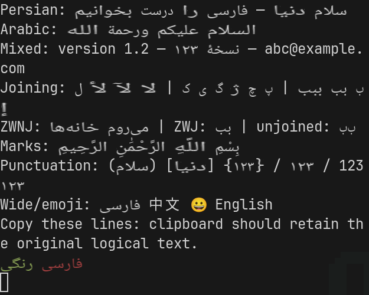
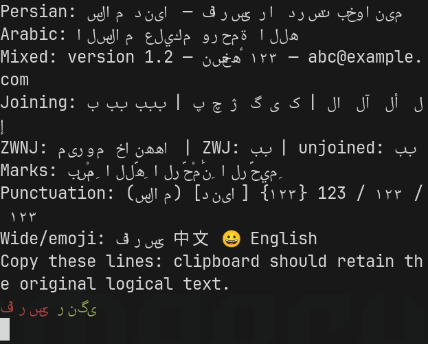

# Arabic and Persian rendering in this fork

This is an experimental fork, not a claim of complete Unicode or terminal-wg
conformance. Research was reviewed on 2026-11-03. The checklist below separates
implementation work from validation; unchecked items remain release blockers for
claiming complete Persian support.

## Trying the experimental renderer

Enable both options in a separate configuration used with the fork's binary:

```toml
[font]
bidi = true
shaping = true
```

Both default to false. HarfRust shaping currently targets FreeType platforms;
native macOS and Windows rasterizers require additional glyph-ID integration.
The current bidi implementation uses an LTR base direction with logical/visual
maps resolved over soft-wrapped paragraphs. Automatic RTL paragraph alignment
and application-controlled terminal-wg modes remain future work. Shaping errors
fall back to the existing character renderer, so readable fallback output alone
does not prove successful shaping.

Implementation currently includes glyph-ID rendering, font-data access, bidi
mapping, and input coordinate conversion. Compilation, unit tests, GPU rendering
and native-language review are separate validation milestones.

## Why a shaping engine is necessary but insufficient

HarfRust converts logical Unicode text in a single font/script/direction run to
font-specific glyph IDs and positions. A separate Unicode Bidirectional Algorithm
implementation must resolve the order of mixed Persian, Arabic, Latin, numbers
and punctuation. Terminal cell ownership, cursor positions, selection and mouse
coordinates then need explicit mappings between logical and visual positions.

The [HarfRust README](https://github.com/harfbuzz/harfrust) describes its Rust port
and lack of platform font-loading integration. It reports performance somewhat
slower than HarfBuzz on common fonts, rather than promising a speed improvement.
The motivation here is Rust integration and genuine OpenType shaping; any speed
claim requires measurements of this fork.

The [HarfBuzz shaping documentation](https://harfbuzz.github.io/what-is-harfbuzz.html)
explains the boundary between shaping and the rest of text layout. Rasterization
must use the same font face, collection index and variation settings that produced
the glyph IDs. Reinterpreting a shaped glyph ID as a Unicode character is invalid.

## Upstream issue and implementation history

- [Alacritty #663](https://github.com/alacritty/alacritty/issues/663), opened in
  2017, remains the main RTL/bidi request. Its discussion distinguishes character
  ordering from glyph shaping and points to terminal-wg and VTE. The maintainer's
  November 2025 explanation is complexity and lack of maintainer familiarity or
  interest, not a demonstrated impossibility or a security feature.
- [Ligatures #50](https://github.com/alacritty/alacritty/issues/50) discusses
  rendering units, cache design and preserving performance for ordinary text.
  The 2019 discussion explicitly raised Arabic/bidi as benefits of run shaping.
  Its history does not establish that switching the shaping language alone solves
  the performance concern.
- [PR #2181](https://github.com/alacritty/alacritty/pull/2181) attempted HarfBuzz
  and FreeType shaping in 2019. It closed unmerged. The author reported incorrect
  rendering and repeated rasterization instead of glyph caching.
- [PR #2677](https://github.com/alacritty/alacritty/pull/2677) continued that work
  with text runs and a glyph-index cache. It also closed unmerged. Its initial
  implementation was Linux-only, ignored shaping positions, and identified font
  fallback and benchmarking as unfinished. These are still useful review topics.
- [OpenType features #3166](https://github.com/alacritty/alacritty/issues/3166)
  tracks related font-feature configuration requests.

The upstream [contribution policy](../CONTRIBUTING.md#llmai-contributions)
rejects LLM-generated contributions, including code, documents, issues and
comments. This work is maintained as the user's independent fork. It must not be
represented as an upstream contribution or submitted there as generated content.

## What established terminals do

[VTE's bidi implementation](https://github.com/GNOME/vte/blob/master/src/bidi.cc)
maintains per-row logical/visual maps and direction metadata. Its identity path
avoids storing a nontrivial map for ordinary LTR text. It computes paragraph-level
bidi information, then reorders each physical row. It handles combining characters
and wide-cell fragments separately. Arabic shaping in that file still uses
FriBidi presentation forms; its own comments propose replacing that approach with
HarfBuzz. It is therefore a useful terminal mapping reference, not evidence of a
complete modern OpenType implementation.

[Konsole's TerminalDisplay::bidiMap](https://github.com/KDE/konsole/blob/master/src/terminalDisplay/TerminalDisplay.cpp)
uses ICU for bidi mapping and presentation-form Arabic shaping, including
lam-alef adjustments to preserve cell counts.
[TerminalPainter](https://github.com/KDE/konsole/blob/master/src/terminalDisplay/TerminalPainter.cpp)
uses those maps for visual placement and cursor/background rendering. Its source
illustrates why converting glyphs without also mapping terminal interactions is
insufficient. These implementations are references, not copied code.

## Intended architecture

1. Retain original Unicode text, attributes and terminal coordinates in the grid.
2. Derive a display-only bidi map and resolved direction for each cell.
3. Segment logical text into font/script/direction runs, preserving joining
   context across paint-only changes where possible.
4. Shape with HarfRust; retain cluster-to-logical-cell ownership and glyph offsets.
5. Rasterize/cache by font face, glyph ID and rendering parameters; fit connected
   runs to their allocated terminal width without altering the application's grid.
6. Apply the same mapping to cursor, decoration, selection, hints and mouse hits.
   Copy and search continue to operate on original logical text.

The [terminal-wg display-only recommendation](https://terminal-wg.pages.freedesktop.org/bidi/recommendation/display-only.html)
is the architectural reference: control sequences continue to modify the logical
model, and reported mouse positions undergo the inverse display transformation.
The [paragraph rules](https://terminal-wg.pages.freedesktop.org/bidi/recommendation/paragraphs.html)
and [basic modes](https://terminal-wg.pages.freedesktop.org/bidi/recommendation/basic-modes.html)
require paragraph context even though reordering happens within physical rows.
The [cursor discussion](https://terminal-wg.pages.freedesktop.org/bidi/recommendation/cursor.html)
also explains why an RTL cell's leading cursor/selection edge is on its right.

An initial per-row implementation cannot claim correct full-paragraph behavior
across soft wraps. Always enabling implicit bidi can also break applications that
already emit visual-order text. The [escape-sequence proposal](https://terminal-wg.pages.freedesktop.org/bidi/recommendation/escape-sequences.html)
defines application control of implicit/explicit layout and base direction.

## Implementation checklist

Checked items describe implemented paths, not a claim that all validation has
passed. Remaining limitations are intentionally visible.

- [x] HarfRust shapes and renderer consumes actual glyph IDs and positioning.
- [ ] Connected Arabic forms and Persian letters پ چ ژ گ ی ک.
- [ ] Required lam-alef ligatures retain correct logical cell ownership.
- [ ] Combining marks, tashkeel and stacked marks remain with their bases.
- [ ] Persian ZWNJ prevents joining; ZWJ has appropriate joining behavior.
- [ ] Mixed RTL/LTR text, ASCII and Persian/Arabic digits, paired punctuation.
- [ ] Unicode bidi controls and isolates have intentional documented handling.
- [ ] Wide glyph continuations and zero-width characters survive mapping.
- [x] Cursor column, selection edges and mouse reports use the matching presentation map.
- [ ] Exact ligature caret placement and RTL I-beam cursor edge.
- [x] Grid storage, copy/paste and search retain original logical Unicode text.
- [ ] Search highlights, hints, hyperlinks, vi cursor and underline decorations.
- [x] Font fallback prefers a face covering each complete word; unavoidable splits retain surrounding context.
- [ ] Bold/italic, foreground changes, selection and cursor do not break joining.
- [ ] Soft-wrap paragraph context, offscreen context, resize/reflow and scrollback.
- [x] Experimental modes conservatively request full display damage.
- [ ] Efficient damage tracking for joining or reordered text.
- [ ] Application-controlled explicit/implicit mode and base direction.
- [x] Default options preserve the original renderer; ASCII avoids HarfRust.
- [ ] Measure overhead with experimental options enabled.
- [x] Bounded shaping/font caches and glyph-ID raster cache.
- [ ] Audit invalidation and variable-font/Fontconfig transformations.

## Validation checklist

Validated on Linux x86_64 with Rust 1.99.1:

- `cargo test --workspace --offline`: 282 passed, zero failures, one ignored
  diagnostic timing test. Includes seven bidi tests, six real-font HarfRust tests,
  and a mixed-direction mouse/selection integration test.
- `cargo build --release -p alacritty --offline`: passed.
- A separate Fontconfig → HarfRust → FreeType probe shaped and rasterized actual
  glyph IDs for `سلام دنیا`, `می‌روم`, marked Arabic, and mixed Persian digits.
- Shaping-code clippy passed in an isolated harness. Vendored crossfont 0.8.1
  emits pre-existing lifetime/style warnings under this newer compiler.

- [x] Workspace compilation and required existing tests.
- [x] New bidi and shaping tests, including font fixtures.
- [ ] Release-build ASCII, Persian and mixed-text benchmark comparisons.
- [x] Wayland GPU launch and visual smoke test of the demo corpus.
- [ ] Native Arabic/Persian review, interactive cursor/selection and copy validation.
- [ ] Platform support and fallback behavior tested beyond Linux.

Isolated release bidi measurements (not end-to-end renderer performance) were
approximately 1.56 µs per 141-column ASCII row and 12.65 µs per 120-column mixed
Persian row. These numbers do not establish a throughput or latency comparison
with upstream Alacritty. Experimental display currently uses full-frame damage.

## GPU preview

Captured from the same Linux debug build with the demo configuration, with both
experimental options enabled and disabled. These previews demonstrate connected
forms and bidi ordering; they are not proof of complete rendering correctness.
Line wrapping, font fallback and run fitting remain review targets.

| Experimental shaping + bidi | Existing renderer |
| --- | --- |
|  |  |

## Manual corpus

Use an Arabic-capable font. Compare output, cursor tracking, drag selection and
copied text. Resize across words and repeat with bold/color changes inside them.

```text
سلام دنیا
فارسی: پ چ ژ گ ی ک — العربية: ي ك
می‌روم می‌خواهم خانه‌ها
بِسْمِ اللَّهِ الرَّحْمَٰنِ الرَّحِيمِ
لا لأ لإ لآ
English فارسی 123 ۱۲۳ ١٢٣ (test) [آزمایش]
فارسی English فارسی /tmp/example.rs:42
سلام 😀 دنیا 漢字
```

Performance verification must separate glyph-cache warmup, shaping-cache warmup,
steady-state redraw, continuously changing text, and ASCII-only output. A passing
unit suite alone does not establish visual correctness or negligible overhead.
